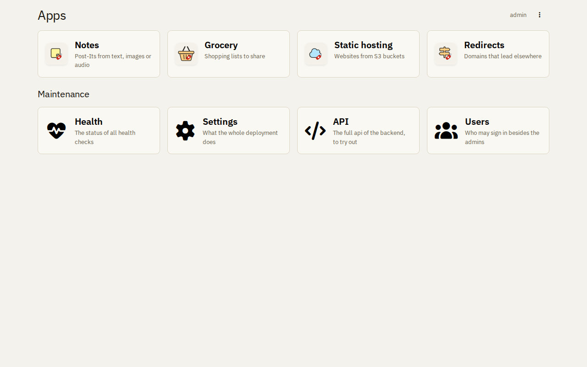
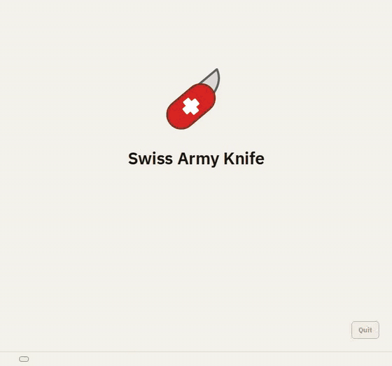
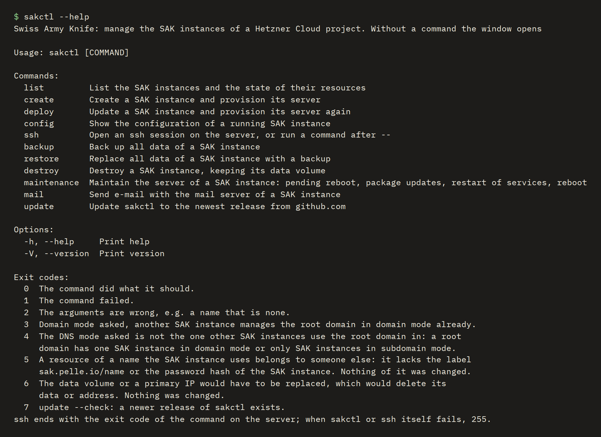
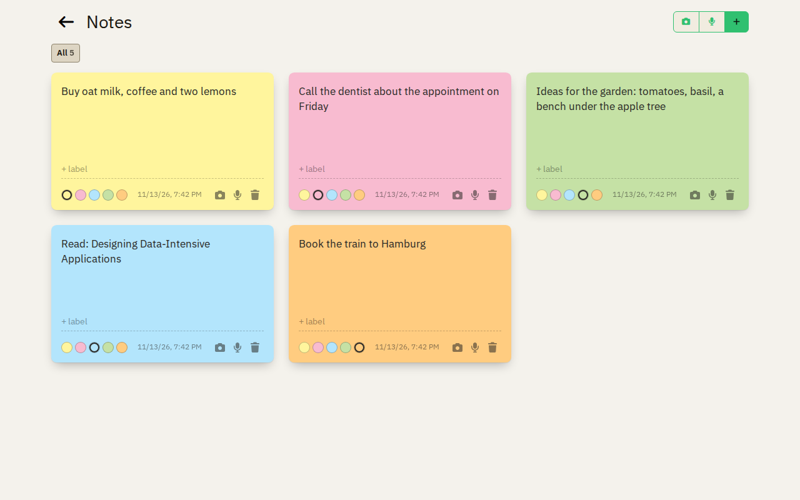
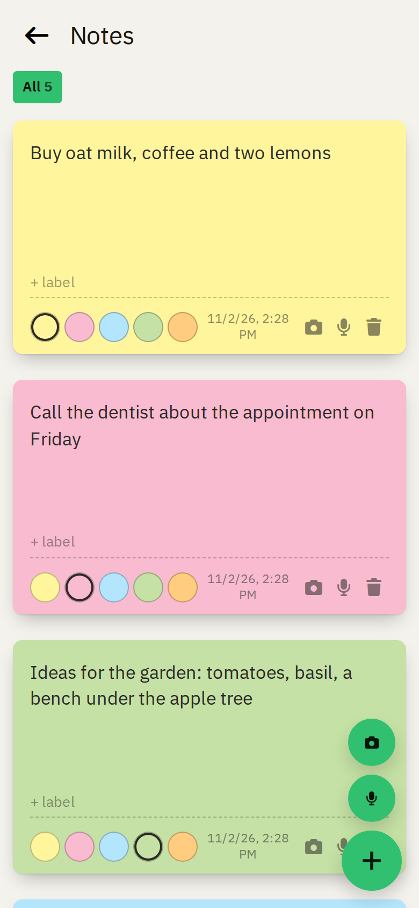
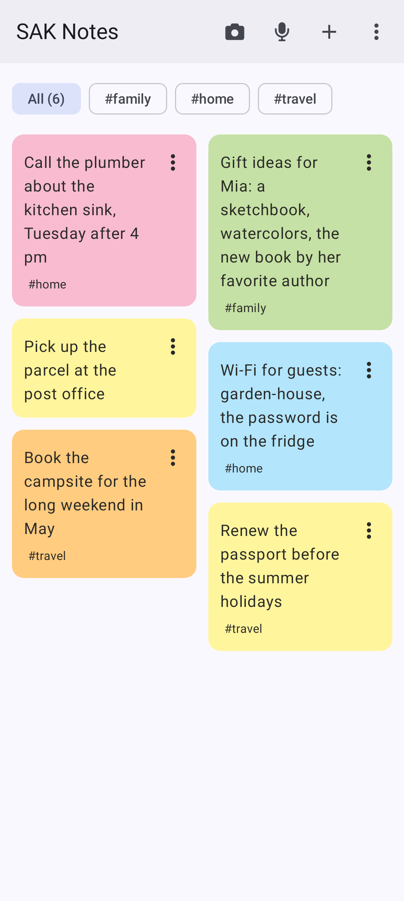
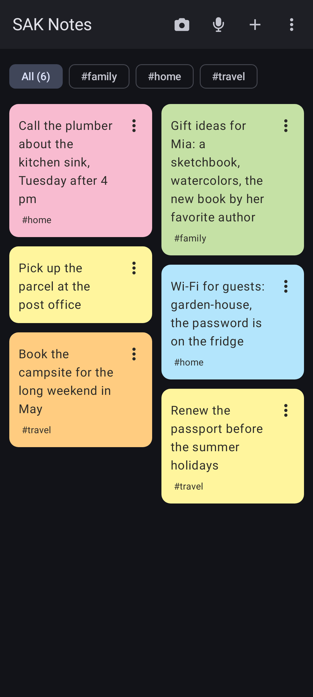

# Swiss Army Knife

<!-- docs-link: the docs home leaves it out, it is the docs -->
<h2 align="center">
  <a href="https://pellepelster.github.io/swiss-army-knife/features/">✨ See all features</a>
  &nbsp;·&nbsp;
  <a href="https://pellepelster.github.io/swiss-army-knife/">📖 Read the documentation</a>
</h2>
<!-- /docs-link -->

Swiss Army Knife is a self-hosted, privacy first micro-cloud for families and small groups: a few apps on your own
server, set up and looked after by one program, sakctl.

<!-- the docs home shows the README up to here, its features page has the rest in detail -->

  

## The apps

- **Notes:** post-its from text, photos and voice recordings, with labels and colors.
- **Grocery lists:** shopping lists, private or shared, grouped by categories, updated live on every device.
- **Static hosting:** websites from S3 buckets, at their own domain or at a subdomain.
- **Redirects:** domains that lead to another address, with automatic TLS certificates.

The notes and the grocery lists also have a native Android app.

## Privacy first

Your data never goes to a third party unless you turn it on. The apps load nothing from outside, and your data stays
on your server. sakctl, the server and the native Android apps download the software of SAK from GitHub, which sees
their IP address but never your data
([all downloads](https://pellepelster.github.io/swiss-army-knife/features/#privacy-first)).

The AI features read the text of a photo or a recording of a note, and the items in a photo for a grocery list. They
are off until an admin turns them on with their own OpenRouter API key, and only the user starts them, with the robot
button.

**No tracking:** no advertising, no analytics, no crash reporting and no other tracking, neither in the web apps nor in
the native Android apps.

## Users

- **Single user:** the admin signs in with the password. No mail server needed.
- **Multiple users:** the admin adds users by their e-mail address. Needs a mail server.
- **No passwords for users:** no sign-up, users sign in with a link sent by e-mail.
- **Simple sharing:** data is private, or shared with everyone. No roles, no groups.

## sakctl

One program on your computer sets up and looks after your SAK instance.

**The UI, for beginners:** guides you from your Hetzner Cloud token to a running SAK instance, and shows a plan before
it changes anything.

  

**The command line, for advanced users:** the same as commands, for scripts and automation (on Windows the program
`sakctl-cli.exe`).

  

Both can install, update and destroy a SAK instance, back up and restore all its data as one encrypted file, maintain
its server, and update themselves.

## Across all devices

Every app works in the browser on a desktop and on a phone, and follows the light or dark mode of the device. On
Android, you can [install it on the home screen](https://pellepelster.github.io/swiss-army-knife/apps/android/web-apps/)
as a web app (PWA).

  

  
  &nbsp;
  
  &nbsp;
  

## Get started

You need a Hetzner Cloud project, a domain whose DNS zone is in that project, and Docker or Podman on your computer.

1. [Install sakctl](https://pellepelster.github.io/swiss-army-knife/installation/).
2. [Create your first SAK instance](https://pellepelster.github.io/swiss-army-knife/first-steps/).

Or read [all features](https://pellepelster.github.io/swiss-army-knife/features/).
