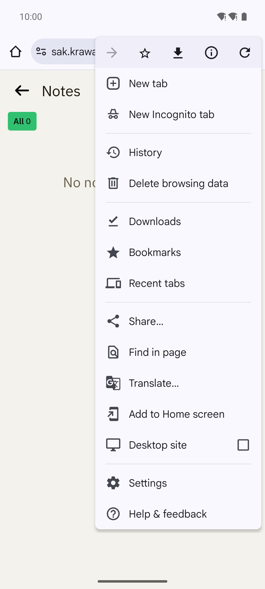
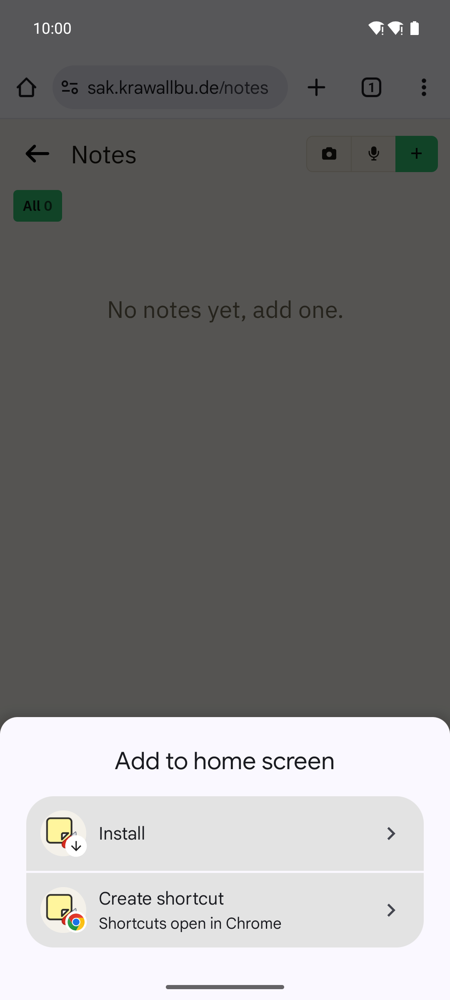
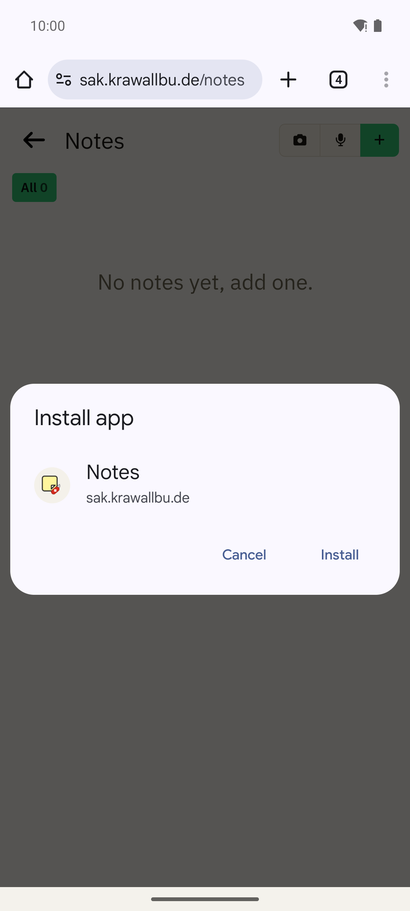
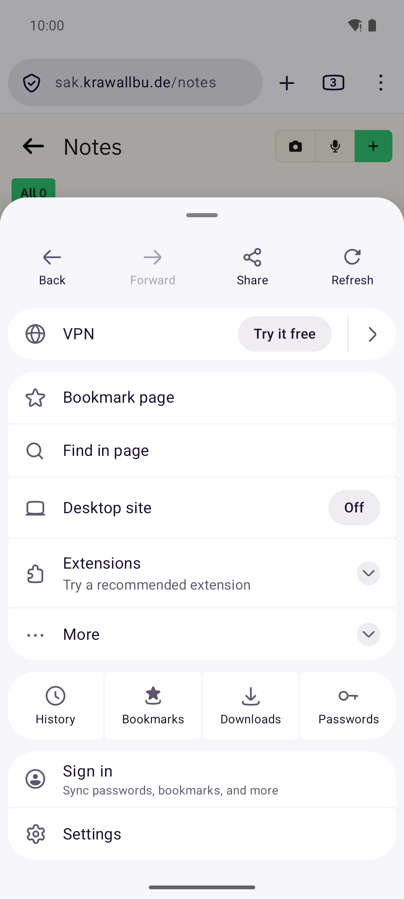
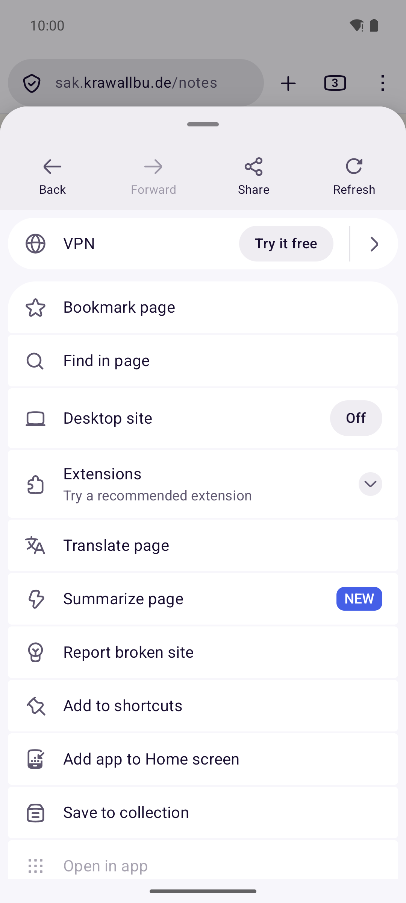
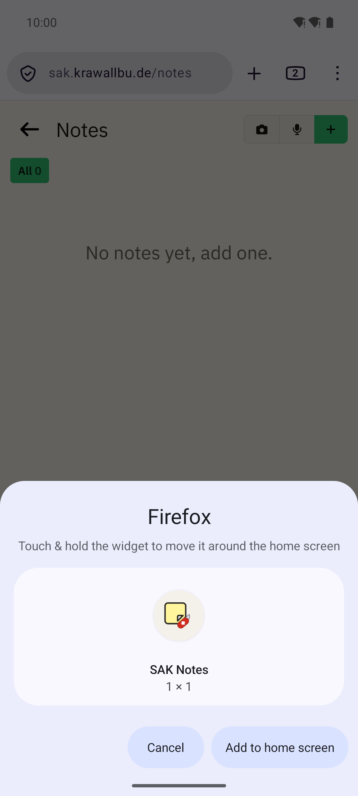
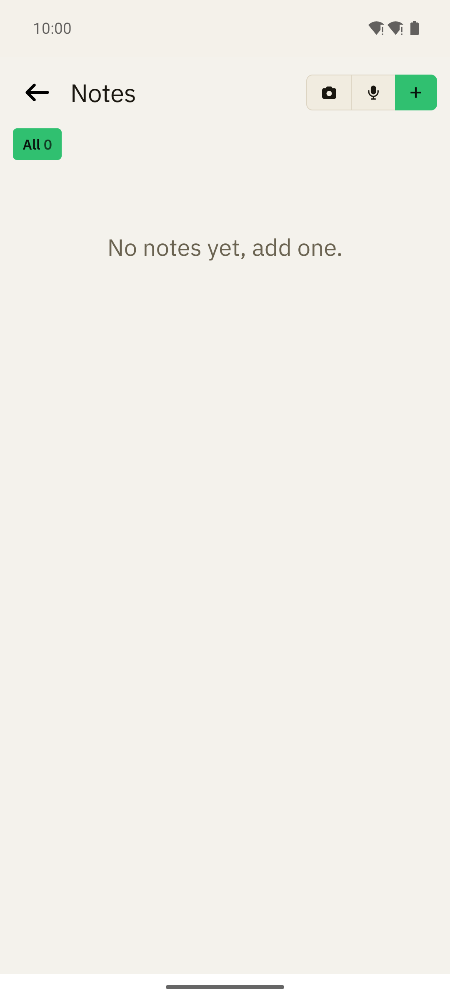

# Install the web apps on Android

You can install SAK Notes and SAK Grocery List from the browser of your phone. An installed web app has an icon on the
home screen and opens without the address bar of the browser. You do not download a file, and Android and Play
Protect show no warnings. The browser keeps the web app up to date. To install the
[native Android apps](native-apps.md) instead, use their own installation steps.

Each app installs from its own page:

- **SAK Notes:** `<SAK address>/notes`
- **SAK Grocery List:** `<SAK address>/grocery`

The steps are the same for both apps. The screenshots show SAK Notes.

## Chrome

1. **Open the page of the app and sign in.**
2. **Open the menu.** Tap ⋮ at the top right, then tap **Add to Home screen**.

   

3. **Select Install.** Chrome asks how to add the app. Tap **Install**. **Create shortcut** adds only a link that
   opens in Chrome.

   

4. **Confirm.** Tap **Install**. The app is on the home screen.

   

## Firefox

1. **Open the page of the app and sign in.**
2. **Open the menu.** Tap ⋮ at the top right, then tap **More**.

   

3. **Select Add app to Home screen.**

   

4. **Confirm.** Android shows the icon of the app. Tap **Add to home screen**.

   

If the menu shows **Add to Home screen** instead of **Add app to Home screen**, Firefox did not find the web app. Then
the icon only opens the page in Firefox. Make sure that the address starts with `https://`.

## Open the app

Tap the icon on the home screen. The app opens without the address bar of the browser.

