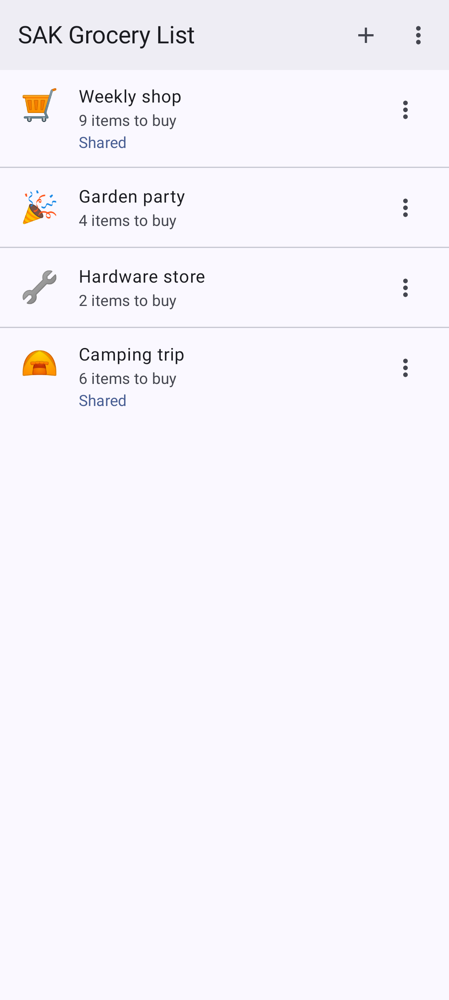
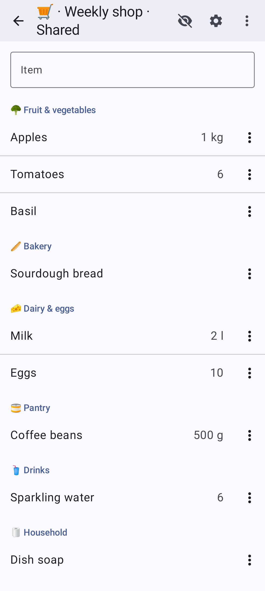
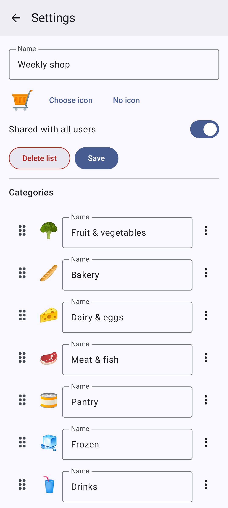
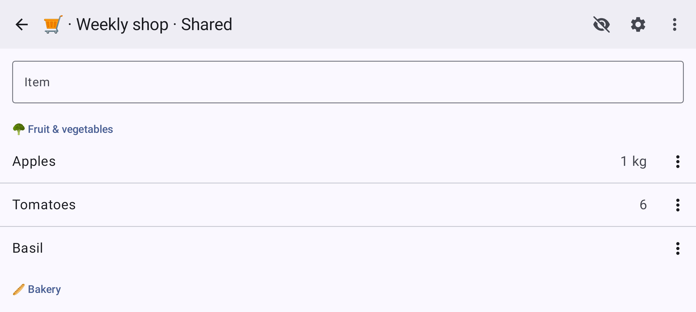

# Grocery lists

Shopping lists, private or shared with everyone, in the browser and in the Android app. Every change shows at once on
every device that has the list open.

## Add and check items

Type an item into the field at the top of a list. Tap an item when you bought it: it is struck through, and you can
undo it for a moment, then it leaves the list. The menu of an item renames it, sets its quantity and unit (for
example `500 g`), its category and its photo, or deletes it.

## A list learns

What you bought before comes back as a suggestion while you type, with its quantity, category and photo. The eye in
the toolbar also shows the bought items, struck through, so you can see what you bought last.

## Categories

Each list has its own categories, each with a name, an icon and a place in the order of the list. The items show in
groups, in that order. Every user who sees a list can change its categories in its settings.

## Items from a photo

With the AI features turned on, the robot next to the field reads the items of a photo of a recipe or a shopping
list, with their quantities. You correct them first; nothing is added before you confirm.

## Turned sideways

On a phone turned sideways or on a tablet, the list uses the whole width.

