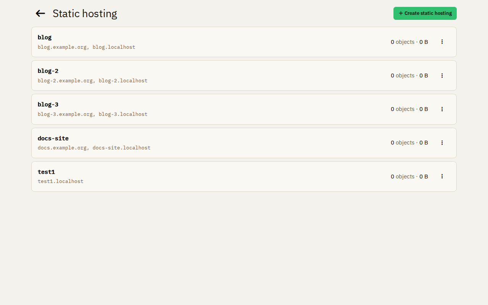
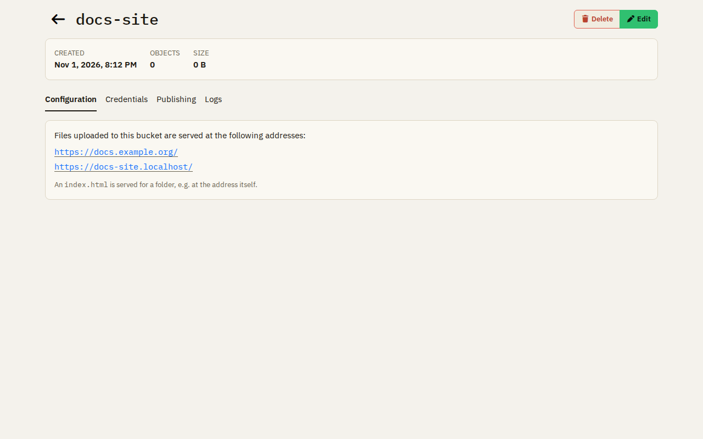

# Static hosting

Static hosting serves websites from S3 buckets. Upload the files of a site with any S3 client, for example the AWS CLI,
and SAK serves them with automatic TLS certificates.

## A bucket

Each bucket is served at `<name>.<base domain>`, and also at your own domains, if you add them. A folder serves its
`index.html`. The page of a bucket shows its addresses, its number of files and its size.

- **Credentials:** each bucket has its own key pair, which accesses only this bucket. If a key pair leaks, replace it:
  the old one stops working at once.
- **Publishing:** the deployment target and the command to publish a [Hugo](https://gohugo.io/) site to the bucket.
  Hugo uploads only what changed and deletes what is gone.
- **Logs:** the requests and the traffic of the site over time, and a search through the single requests.

## Your own domain

Add your domain to the bucket and create a DNS record that points it at the server of your SAK instance. SAK gets the
TLS certificate for it. To send another domain to the site, for example `www.example.org`, use a
[redirect](redirects.md).
