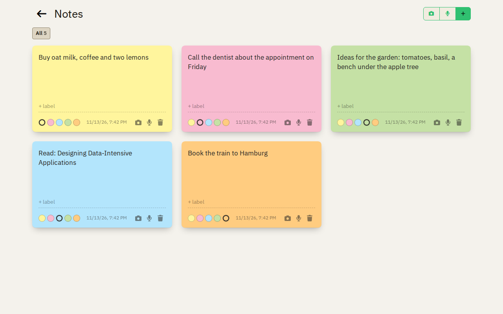
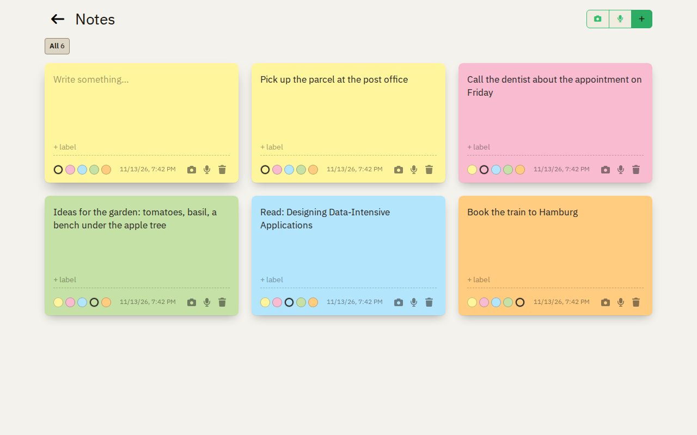
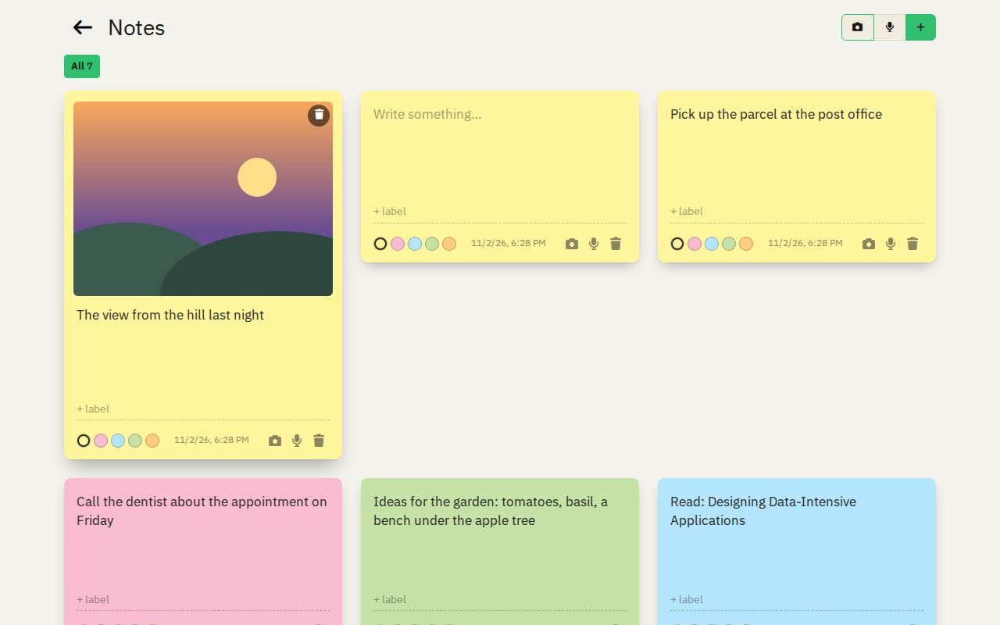
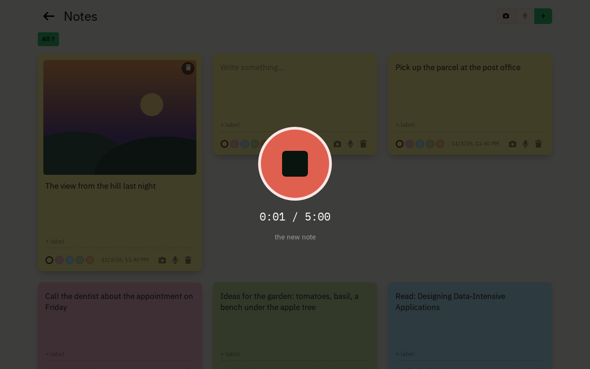
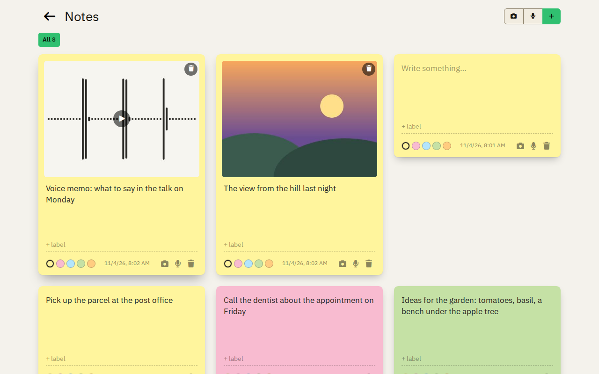
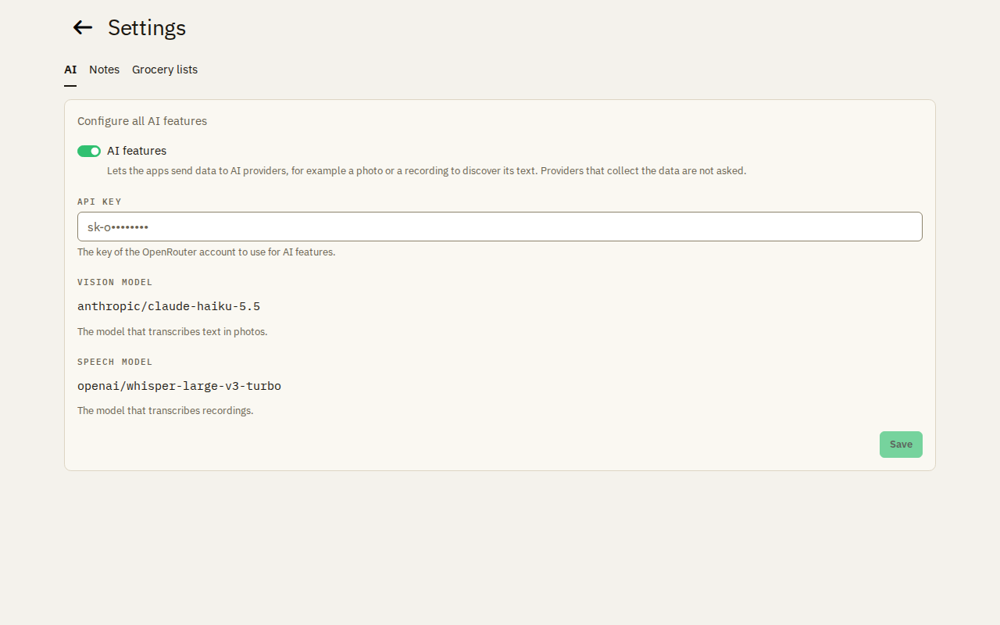
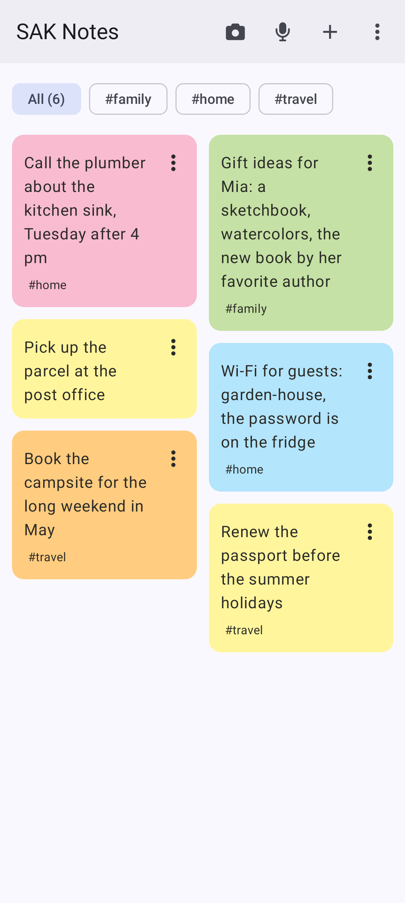
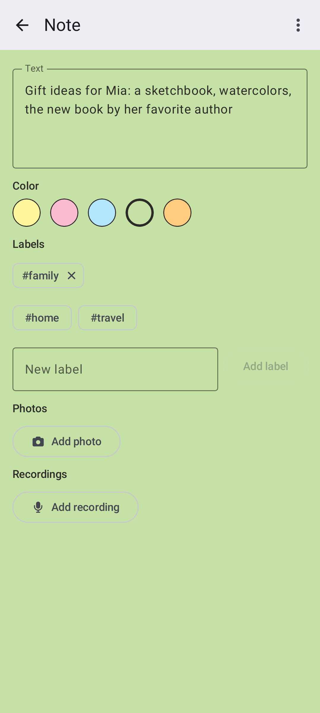
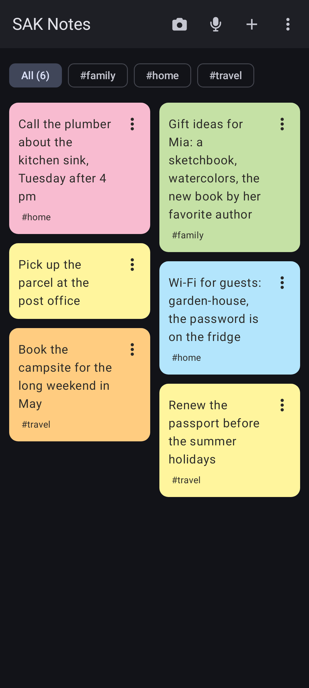

# Notes

Notes are post-its on a wall: text, photos and voice recordings, each with a color and labels.

## Write a note

Type a note, give it a color and labels. A filter shows only the notes of one label.

## Photos and recordings

A note can hold photos and voice recordings. Record directly in the browser or in the app.

## Text from a photo or a recording

With the AI features turned on, the robot button reads the text of a photo or a recording into the note. Only you
start it, for one photo or recording at a time. An admin turns the AI features on in the settings, with the API key of
their own OpenRouter account.

## On Android

The native app has what the web app has. Photos that you share from another app, for example the gallery, become a
new note. Pull the wall down to load it again.

