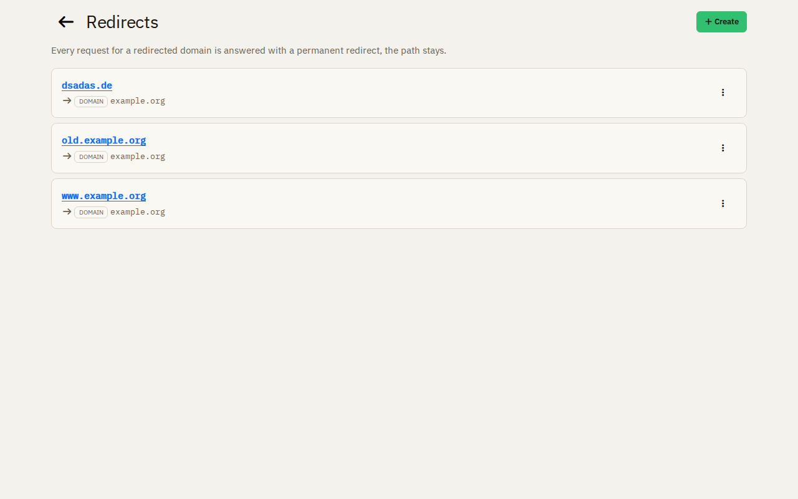
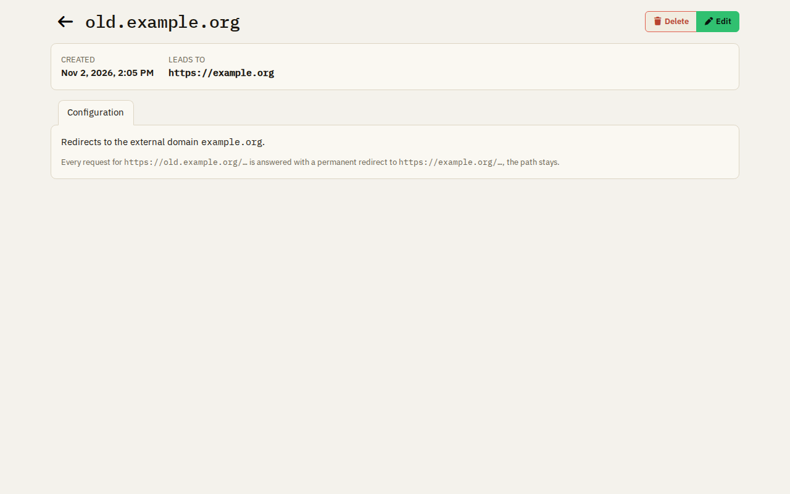

# Redirects

A redirect sends every request for a domain to another address, with its path. Its TLS certificate is issued and
renewed automatically.

## The target

- **An external domain:** for example `old.example.org` to `example.org`. A request for
  `https://old.example.org/about` goes to `https://example.org/about`.
- **A bucket:** the redirect leads to where the [site of the bucket](hosting.md) is served now, and follows it when
  its domains change. The bucket cannot be deleted while a redirect leads to it.

The domain of a redirect cannot be changed; delete the redirect and create a new one. A domain of a redirect cannot be
used by a bucket or by the apps.
