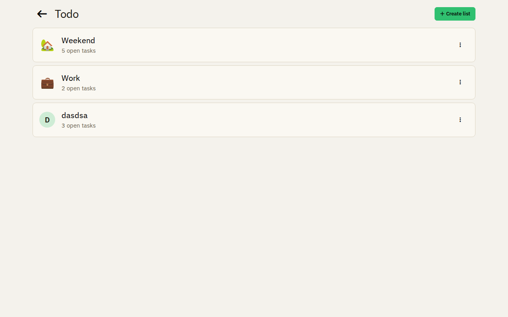
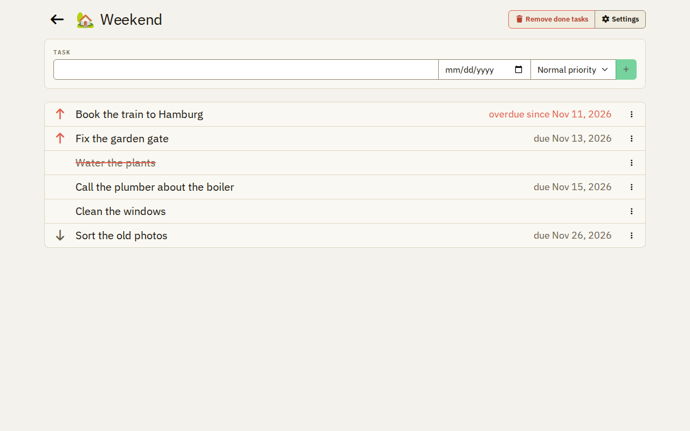
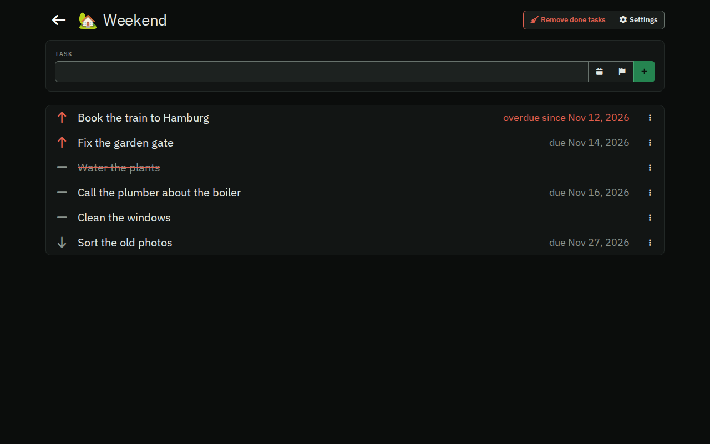
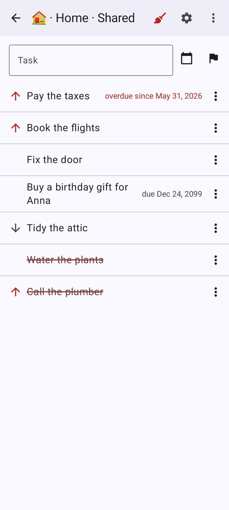
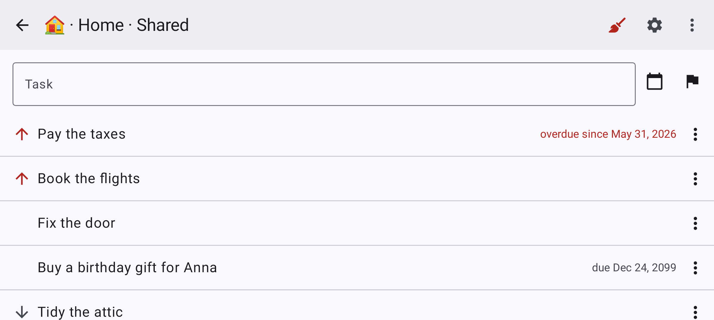

# Todo lists

Tasks, private or shared with everyone, in the browser and in the Android app. Every change shows at once on every
device that has the list open.

## Add a task

Type a task into the field at the top of a list. The calendar button next to it gives the task a due date, the flag
its priority. Both are optional.

## Priority and due date

A task is of high, normal or low priority. The high ones come first, with an arrow up; the low ones show an arrow
down. A due date shows next to the task, in red when the day has passed. The menu of a task changes its priority and
adds or removes its due date.

## Done

Tap a task when it is done. It stays in its place, struck through, and a second tap opens it again. **Remove done
tasks** in the toolbar removes all done tasks of the list; you can undo this for a moment.

## Dark mode and Android

The apps follow the light or dark mode of the device. The native Android app has what the web app has.

