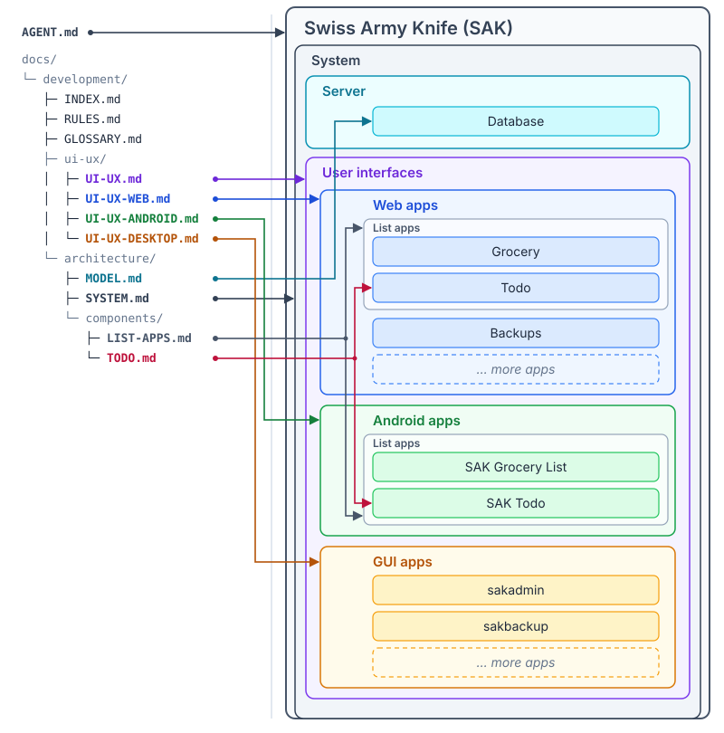

# Development

## Architecture

- [System Architecture](architecture/SYSTEM.md): how SAK is built as a whole.
- [Architecture of the Components](architecture/components/INDEX.md): what all components share, and each component:
  [Static Hosting](architecture/components/HOSTING.md), [Redirects](architecture/components/REDIRECTS.md),
  [Notes](architecture/components/NOTES.md), [Grocery](architecture/components/GROCERY.md),
  [Todo](architecture/components/TODO.md), [Health](architecture/components/HEALTH.md),
  [Backup](architecture/components/BACKUP.md), [sakadmin](architecture/components/SAKADMIN.md).

## UI and UX

- [UI and UX](ui-ux/UI-UX.md): the rules all apps share.
- [Web app](ui-ux/UI-UX-WEB.md), [Android apps](ui-ux/UI-UX-ANDROID.md), [desktop apps](ui-ux/UI-UX-DESKTOP.md): what only one kind of
  app does.

## Rules and words

- [Rules](RULES.md): how a rule is made and written.
- [Glossary](GLOSSARY.md): the words of SAK.

## Open work

- [Issues](ISSUES.md): what is to do and not yet done.
- [Accepted Risks](ACCEPTED-RISKS.md): the weaknesses kept on purpose.
- [Dependency Updates](DEPENDENCIES.md): how Renovate updates the dependencies.

## Reviews

- [Security](reviews/security-review.md), [supply chain](reviews/supply-chain-review.md),
  [backups with restic](reviews/backup-review.md), [data model](reviews/data-model-review.md),
  [desktop apps](reviews/desktop-apps-review.md), [texts](reviews/i18n-texts-review.md).
