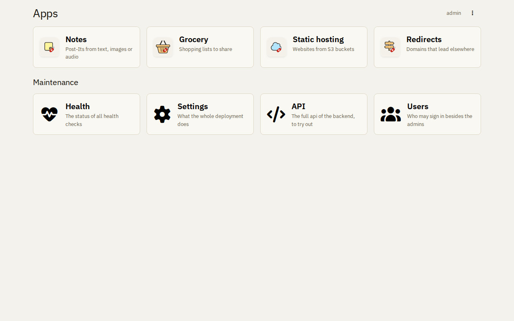
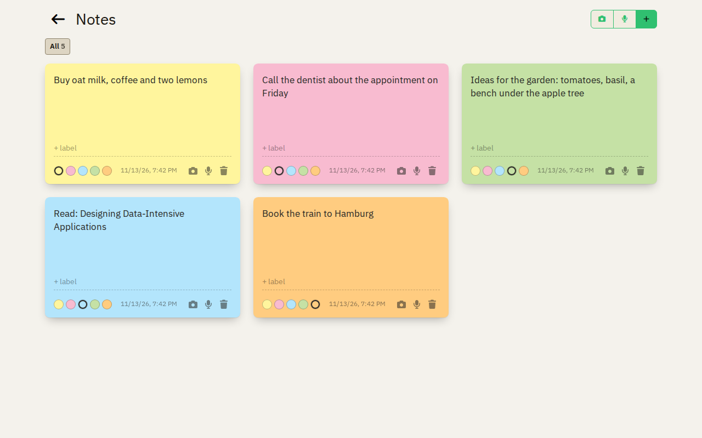
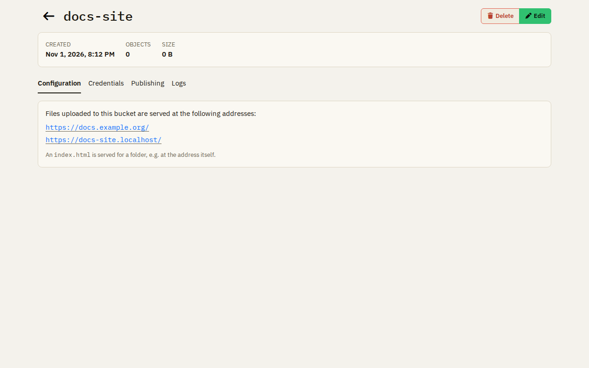
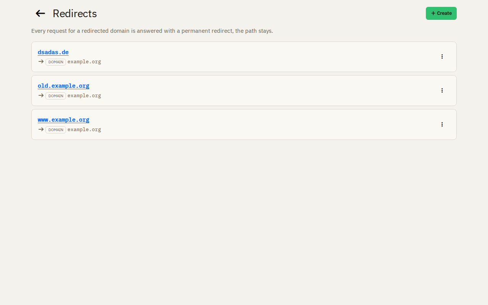
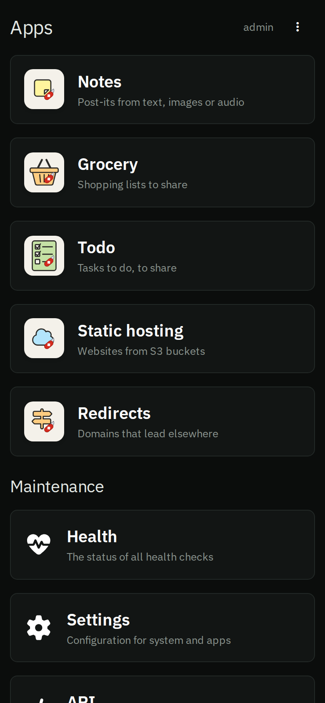
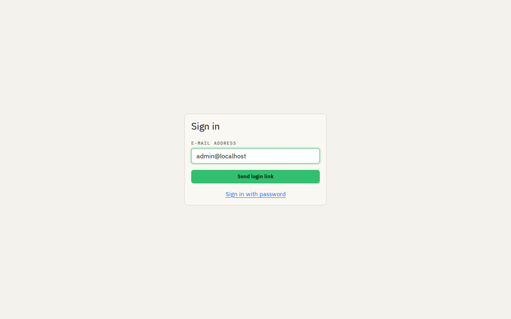
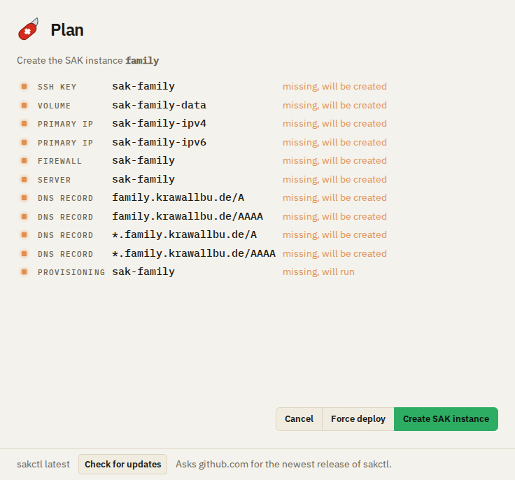
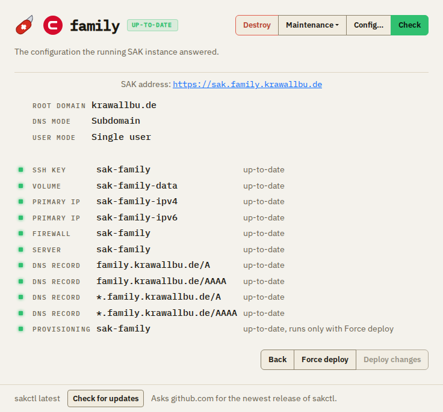

# Features

Swiss Army Knife is your own micro-cloud for a family or a small group: a few apps on a server of yours, set up and
looked after by one program, sakctl.

## Privacy first

Nothing sends data to a third party unless you turn it on and agree to it first. The apps load nothing from outside,
and all data stays on your own server.

## The apps

### Notes

Post-its from text, photos and voice recordings, sorted with labels and in colors. When you turn it on, the text in a
photo or a recording is written into the note on request.

### Grocery lists

Shopping lists, private or shared with everyone of the deployment. A checked item goes after a moment, unless you undo
it, and stays as bought: the eye in the toolbar shows the bought items too. What you added to a list before comes back
as a suggestion on that list. Each list groups its items by its own categories, with a name and an icon, which its
owner changes in the settings of the list. Every change shows at once on every device that has the list open, also in
the Android app, which downloads from `sak.<your domain>/grocery/download/app`.

### Static hosting

Websites from S3 buckets, at their own domain or at a subdomain of the deployment. Each site shows its requests and
its traffic.

### Redirects

Domains that lead to another address: an external domain, or the site of a bucket.

## On every device

All apps work on a phone as well as on a desktop, in the light and the dark mode of the device. On a phone you can
install them on the home screen.

## Users

- **Single user:** you sign in with the password of the deployment; no mail server is needed.
- **Multiple users:** your users sign in with a link by e-mail, you add them by their address. Data is either private
  to the one who made it or shared with everyone of the deployment, no roles per item, no groups.

## sakctl

One program on your computer, as a window or on the command line, sets up and looks after your deployment. Before
anything changes it shows a plan of what it will create, change or delete.

- **Install, update and remove** a deployment; a deploy brings it to the version of sakctl.
- **Backup and restore** all data of a deployment as one encrypted file on your computer.
- **Server maintenance:** upgrade the packages of the server and reboot it, without interrupting a backup.
- **Self-update:** sakctl replaces itself with its newest release when you ask for it.

Next: how [sakctl and your deployment](overview.md) belong together, or [install sakctl](installation.md).
