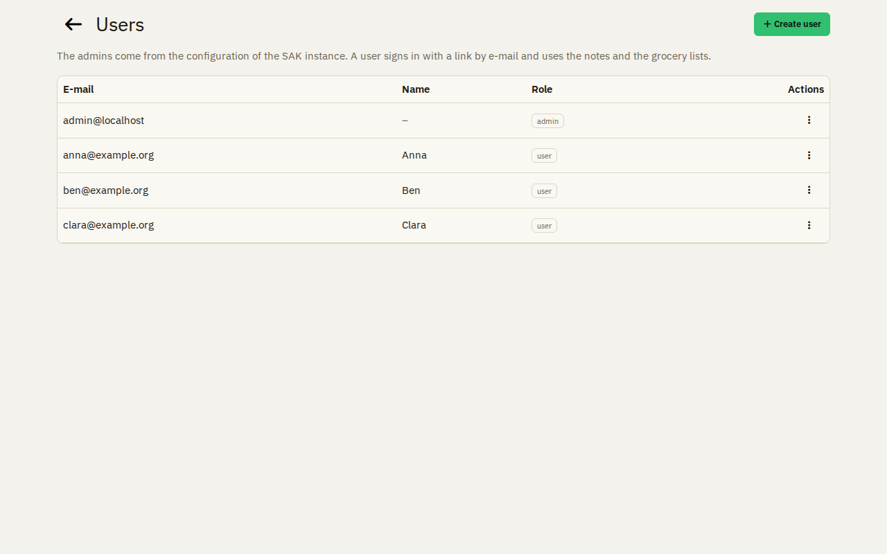
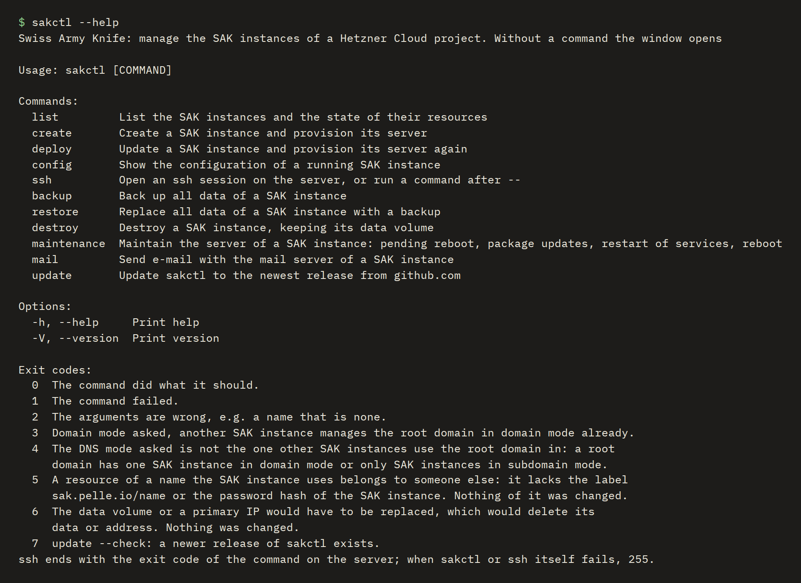
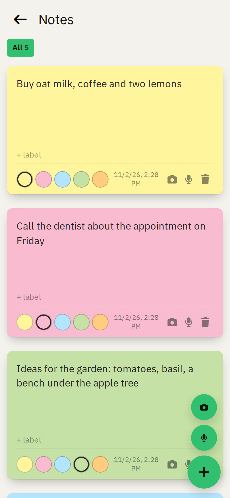
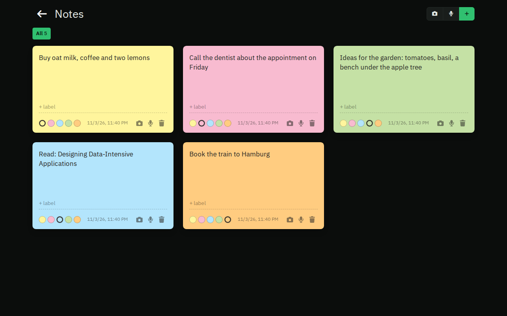

# Features

Swiss Army Knife is a self-hosted micro-cloud for families and small groups: a few apps on your own server, set up and
looked after by one program, sakctl.

## Privacy first

Nothing goes to a third party unless you turn it on. The apps load nothing from outside, and your data stays on your
server.

**Downloads from GitHub:** the software of SAK comes from GitHub. GitHub sees the IP address of the computer, the
server or the phone that downloads, but never your data:

- sakctl and its updates come from the GitHub releases. sakctl updates only when you ask.
- At each start, sakctl downloads the container image of its tools from the GitHub container registry (`ghcr.io`).
- At each deploy, the server of your SAK instance downloads the container images of SAK from `ghcr.io`, and the two
  images for its logs (VictoriaLogs and Vector) from Docker Hub.
- The native Android apps and their updates come from the GitHub releases. An app updates only when you start the
  update.

**No tracking:** no advertising, no analytics, no crash reporting and no other tracking, neither in the web apps nor in
the Android apps. Read the [privacy policy of the Android apps](apps/android/privacy.md).

The AI features read the text of a photo or a recording of a note, and the items in a photo for a grocery list. They
are off until an admin turns them on with the API key of their own OpenRouter account. They never start
automatically: only the user starts them, with the robot button, for one photo or one recording at a time. Providers
that collect data are never used.

## Users

- **Single user:** the admin signs in with the password. No mail server needed.
- **Multiple users:** the admin adds users by their e-mail address. Needs a mail server.
- **No accounts:** no sign-up and no passwords to remember, users sign in with a link sent by e-mail.
- **Simple sharing:** data is private, or shared with everyone. No roles, no groups.

Sign in with just your e-mail address:

## sakctl

One program on your computer sets up and looks after your SAK instance.

**The UI, for beginners:** guides you from your Hetzner Cloud token to a running SAK instance, and shows a plan before
it changes anything.

**The command line, for advanced users:** the same as commands, for scripts and automation.

Both can:

- **Install, update and remove** a SAK instance.
- **Back up and restore** all data, as one encrypted file on your computer.
- **Maintain the server:** upgrade its packages and reboot it, without interrupting a backup.
- **Update itself** when you ask; the next deploy updates the server too.

## Across all devices

Every app works in the browser on a desktop and on a phone, and installs on the home screen (PWA, [install the web apps on Android](apps/android/web-apps.md)). The notes and the
grocery lists also have an Android app; [install the native Android apps](apps/android/native-apps.md).

On a desktop:

In the browser of a phone:

In the Android app:

## Light and dark

Every app follows the light or dark mode of the device.

## The apps

### Notes

Post-its from text, photos and voice recordings, with labels and colors. If you turn on the AI features, the text of a
photo or a recording goes into the note.

### Grocery lists

Shopping lists, private or shared, grouped by categories you choose. A checked item can be undone and stays visible as
bought; what you added before comes back as a suggestion. Every change shows at once on every device.

### Static hosting

Websites from S3 buckets, at their own domain or at a subdomain, with their requests and traffic.

### Redirects

Domains that lead to another address: an external domain, or the site of a bucket. Their TLS certificates are issued
and renewed automatically.

Next: how [sakctl and your SAK instance](overview.md) belong together, or [install sakctl](installation.md).
