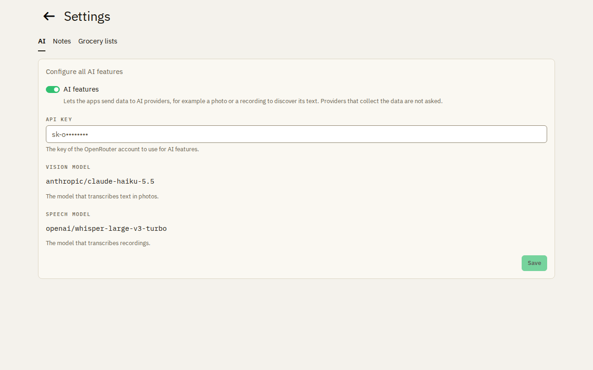
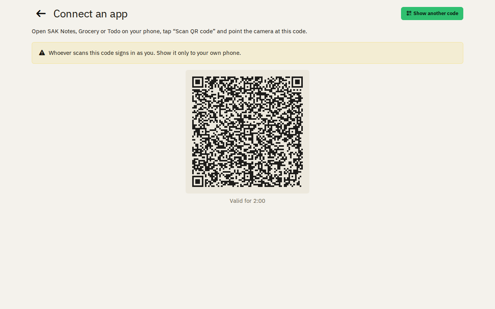
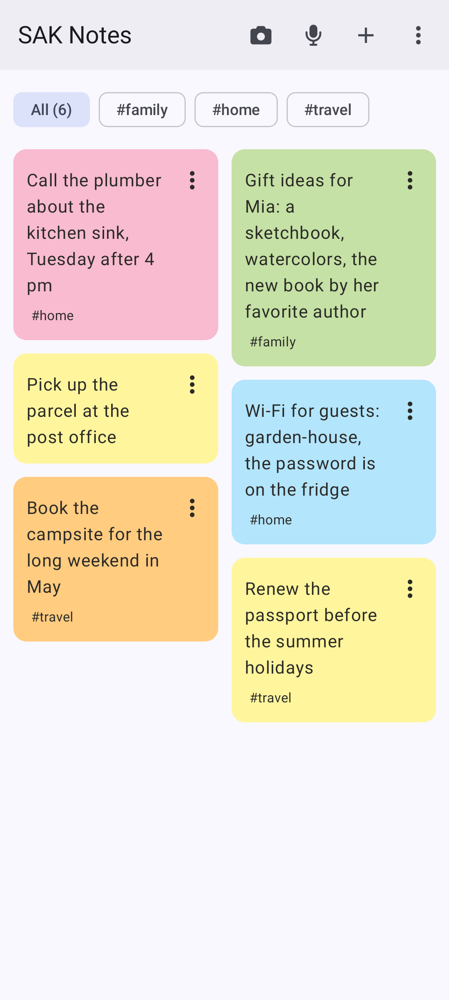
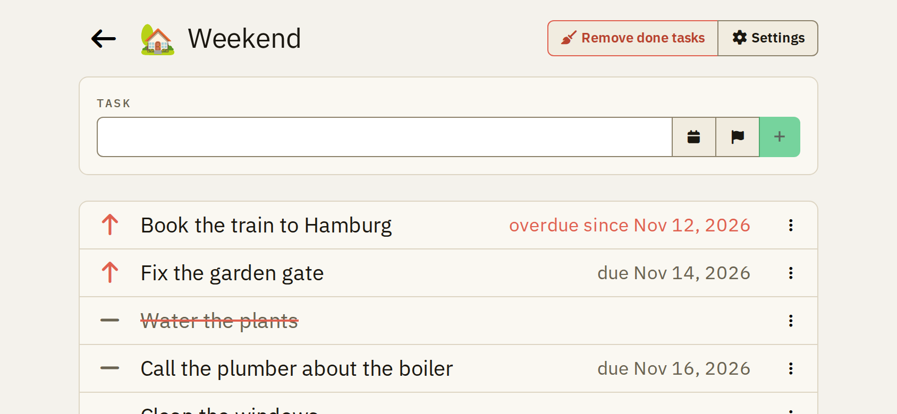
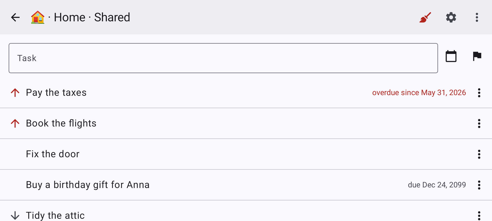
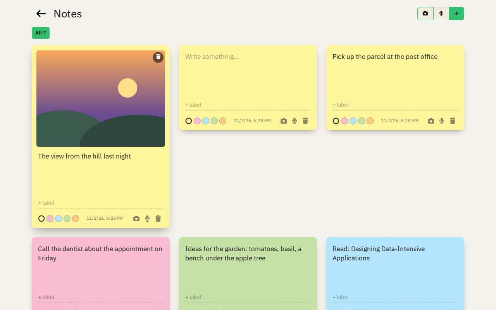
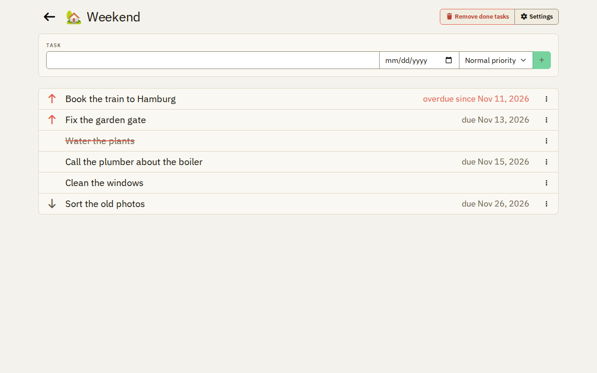
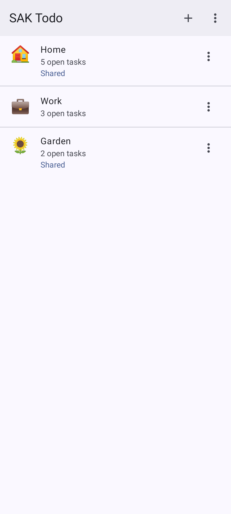

# Features

Swiss Army Knife is a self-hosted micro-cloud for families and small groups: a few apps on your own server, set up and
looked after by one program, sakctl.

## Privacy first

Your data stays on your server and goes to no third party unless you turn it on. The apps load nothing from outside.

**Downloads from GitHub:** the software of SAK comes from GitHub. GitHub sees the IP address of the computer, server
or phone that downloads, never your data:

- sakctl and its updates come from the GitHub releases, and sakctl updates only when you ask.
- At each start, sakctl downloads the image of its tools from the GitHub container registry (`ghcr.io`).
- At each deploy, the server downloads the images of SAK from `ghcr.io`, and the two images for its logs
  (VictoriaLogs and Vector) from Docker Hub.
- The native Android apps and their updates come from the GitHub releases. An app updates only when you start it.

**No tracking:** no advertising, analytics, crash reporting or other tracking, in the web apps and in the native
Android apps. Read the [privacy policy of the Android apps](apps/android/privacy.md).

**AI features:** they read the text of a photo or a recording of a note, and the items in a photo for a grocery list.
They are off until an admin turns them on with the API key of their own OpenRouter account. Only the user starts them,
with the robot button, for one photo or recording at a time. Providers that collect data are never used.

## Users

- **Single user:** the admin signs in with the password. No mail server needed.
- **Multiple users:** the admin adds users by their e-mail address. Needs a mail server.
- **No passwords for users:** no sign-up, users sign in with a link sent by e-mail.
- **Simple sharing:** data is private, or shared with everyone. No roles, no groups.
- **Connect an app with a QR code:** the web app shows a QR code, the Android app scans it and is signed in.

Connect an Android app with a QR code, from the menu of the start page:

Sign in with just your e-mail address:

## sakctl

One program on your computer sets up and looks after your SAK instance.

**The UI, for beginners:** guides you from your Hetzner Cloud token to a running SAK instance, and shows a plan before
each change.

**The command line, for advanced users:** the same as commands, for scripts and automation.

Both can:

- **Install, update and destroy** a SAK instance.
- **Back up and restore** all data, as one encrypted file on your computer.
- **Maintain the server:** upgrade its packages and reboot it, never during a backup.
- **Update themselves** when you ask; the next deploy updates the server too.

## Across all devices

Every app works in the browser on a desktop and on a phone. On Android, you can
[install it on the home screen](apps/android/web-apps.md) as a web app (PWA). The notes, grocery lists and todo lists
also have [native Android apps](apps/android/native-apps.md).

On a desktop:

In the browser of a phone:

In the native Android app:

Turned sideways, on a phone or a tablet, the apps use the whole width:

## Light and dark

Every app follows the light or dark mode of the device.

## The apps

### Notes

[More about the notes](apps/notes.md).

Post-its from text, photos and voice recordings, with labels and colors. With the AI features on, the text of a photo
or a recording goes into the note.

### Grocery lists

[More about the grocery lists](apps/grocery.md).

Shopping lists, private or shared, grouped by your own categories. A checked item can be undone and stays visible as
bought; what you added before comes back as a suggestion. Every change shows at once on every device.

### Todo lists

[More about the todo lists](apps/todo.md).

Tasks, private or shared, with a priority (high, normal or low) and an optional due date. High priority comes first;
an overdue task shows in red. A task you tap as done stays in its place, struck through, until you remove the done
tasks (you can undo this for 2 seconds). The menu of a task changes its priority and its due date. Every change shows
at once on every device.

### Static hosting

[More about static hosting](apps/hosting.md).

Websites from S3 buckets, at their own domain or at a subdomain, with their requests and traffic.

### Redirects

[More about the redirects](apps/redirects.md).

Domains that lead to another address: an external domain, or the site of a bucket. Their TLS certificates are issued
and renewed automatically.

Next: how [sakctl and your SAK instance](overview.md) belong together, or [install sakctl](installation.md).
