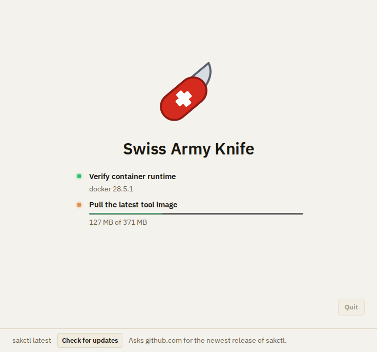
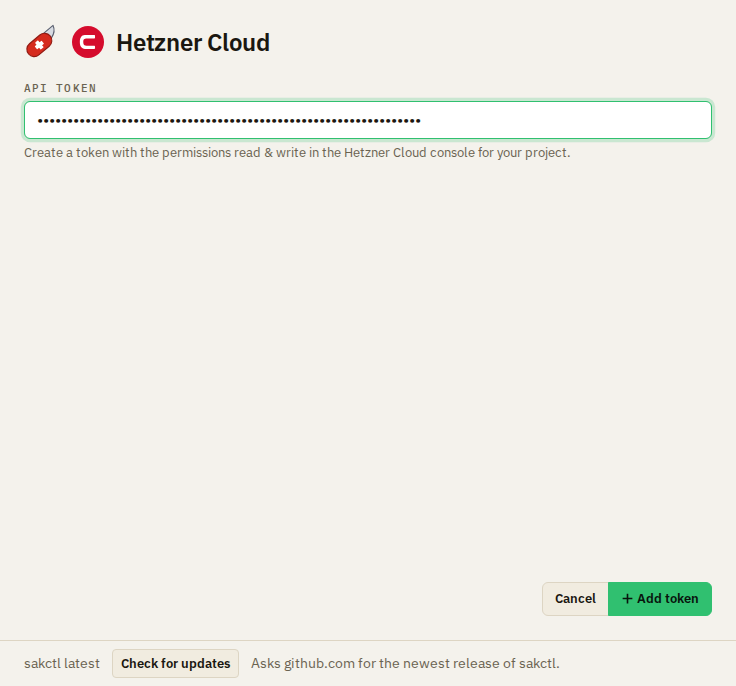
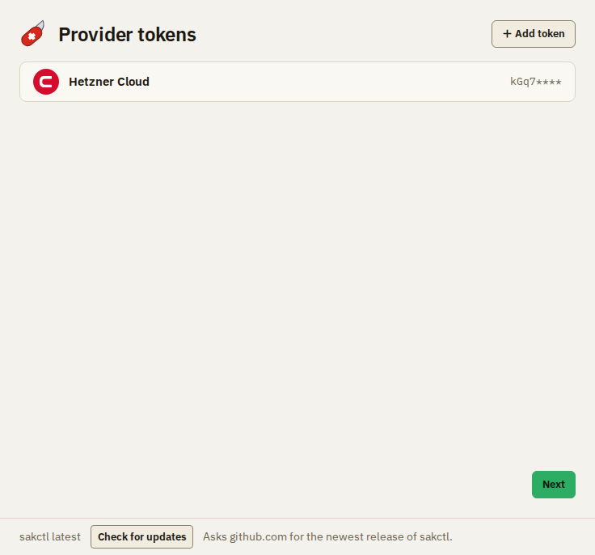
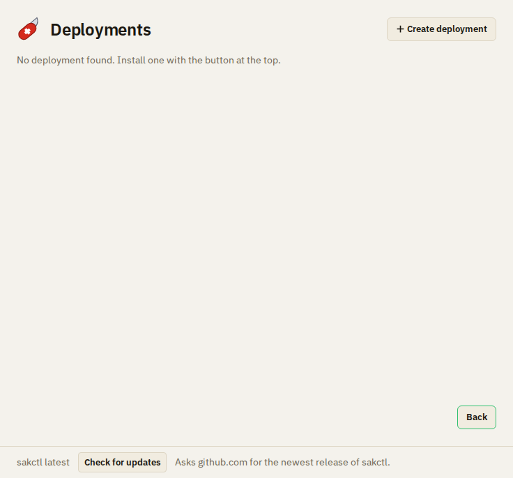
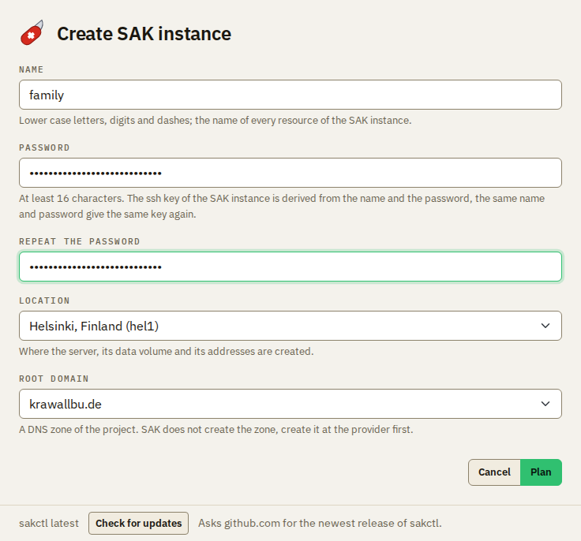
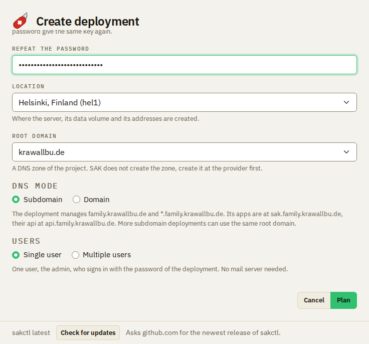
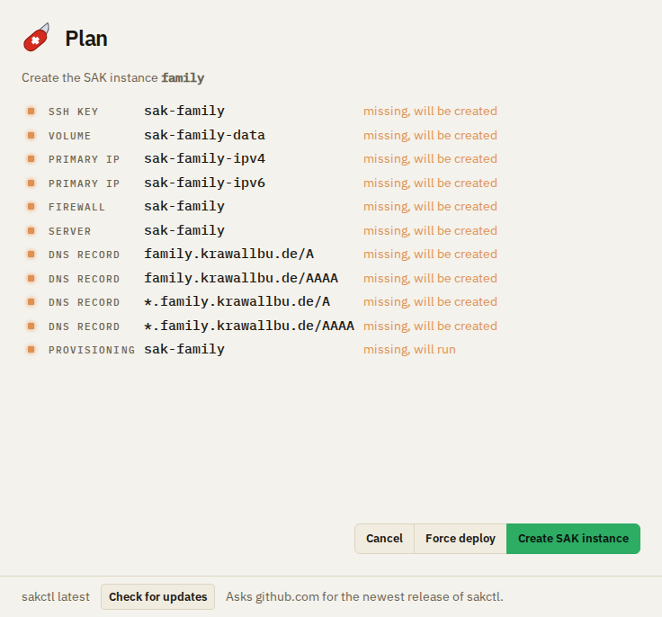
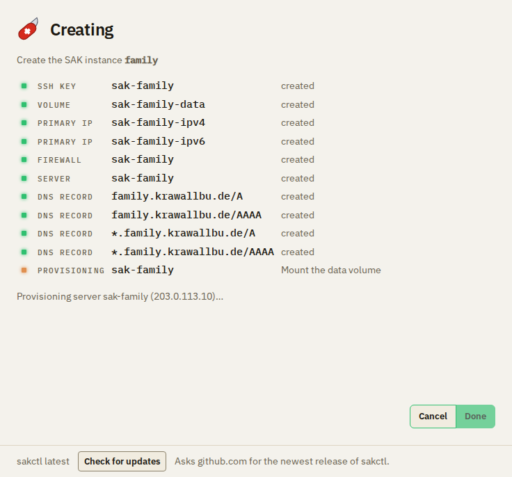
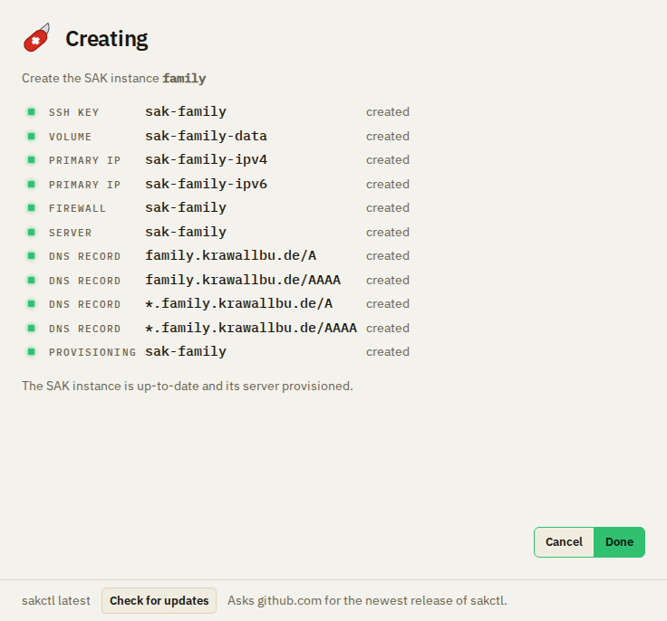
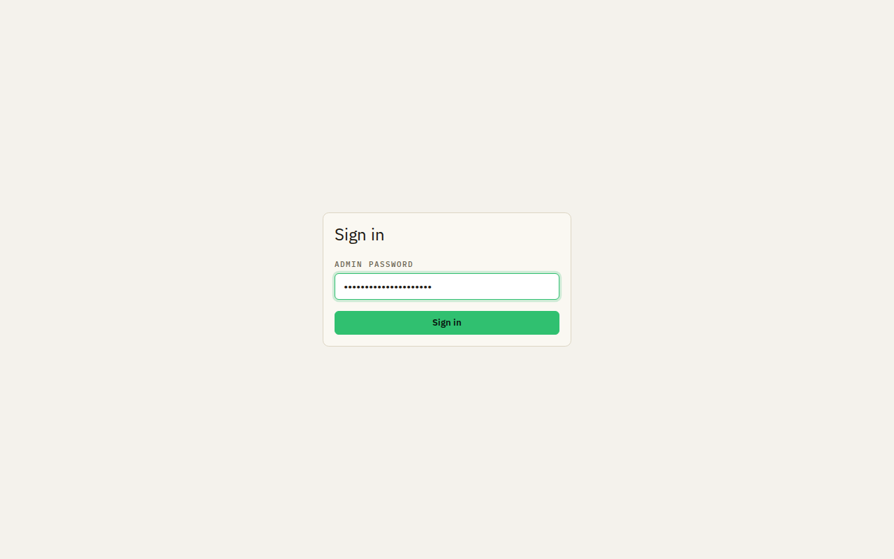

# First steps

After you [install sakctl](installation.md), you create your first SAK instance. First choose two modes: the DNS mode
and the user mode. Then follow the steps below to create a SAK instance for a single user.

## The DNS mode

A SAK instance uses a **root domain**, for example `example.org`. The root domain is a DNS zone in your Hetzner Cloud
project. SAK does not create the zone: create it in the Hetzner Cloud Console first. The **DNS Mode** sets which DNS
records the SAK instance manages and where its apps are, its SAK address:

| DNS Mode                  | DNS records that the SAK instance manages        | SAK address, for example `family` and `example.org` |
|---------------------------|--------------------------------------------------|-----------------------------------------------------|
| **Subdomain** (default)   | `<name>.<root domain>`, `*.<name>.<root domain>` | `https://sak.family.example.org`                    |
| **Domain**                | `<root domain>`, `*.<root domain>`               | `https://sak.example.org`                           |

- Use **Subdomain** in most cases. More SAK instances can use the same root domain, and the records of the root
  domain itself do not change.
- Use **Domain** only for a root domain that has no other use. The SAK instance replaces the address records of the
  root domain, so for example a website at `example.org` no longer works. No other SAK instance can use this root
  domain.

## The user mode

The **Users** of a SAK instance are one of two modes:

- **Single user:** one user, the admin, who signs in with the password of the SAK instance. You need no mail server.
- **Multiple users:** the admin adds users by their e-mail address. The users sign in with a link that they get by
  e-mail, the admin also with the password. You need a mail server (SMTP) that sends the links.

Start with **Single user** if you use SAK alone or want to try it.

## Create a SAK instance for a single user

You need:

- sakctl and Docker or Podman, see [Installation](installation.md);
- the API token of your Hetzner Cloud project, with read and write access;
- the DNS zone of your root domain in the same project.

1. **Start sakctl.** sakctl finds Docker or Podman and downloads the image of its tools. The first time, this takes
   a few minutes.

   

2. **Add the API token.** Click **Add token**, select **Hetzner Cloud**, paste the API token and click **Add
   token**. sakctl checks the token: it creates an SSH key in the project and deletes it again. sakctl keeps the
   token only while it runs, so it asks for the token again at the next start.

   

3. **Go on.** The token is in the list **Provider tokens**. Click **Next**.

   

4. **Start the creation.** The list **SAK instances** is empty at first. Click **Create SAK instance**.

   

5. **Fill in the form.**
   - **Name:** lower case letters, digits and dashes, for example `family`. In the DNS mode **Subdomain**, the name
     is part of the SAK address.
   - **Password** and **Repeat the password:** at least 16 characters. You sign in to the apps with this password,
     and sakctl needs it and the name to manage the SAK instance. Keep it in a safe place: nobody can recover a lost
     password, and the backups need it too.
   - **Location:** where the server is.
   - **Root domain:** the DNS zone of your project.
   - **DNS Mode:** **Subdomain**, see [the DNS mode](#the-dns-mode).
   - **Users:** **Single user**. Leave **Admin e-mail address (optional)** empty.

   

   

   Then click **Plan**.

6. **Read the plan.** The plan shows each resource that sakctl creates in your project: the SSH key, the data volume,
   the addresses, the firewall, the server, the DNS records and the provisioning of the server. Nothing has changed
   yet. Click **Create SAK instance**.

   

7. **Wait.** sakctl creates the resources and sets up the server. This takes a few minutes.

   

8. **Done.** When each resource is created, click **Done**. The page of the SAK instance shows its configuration and
   its resources.

   

9. **Sign in.** Open the SAK address in a browser, for example `https://sak.family.example.org`. Enter the password
   in **Admin password** and click **Sign in**.

   

Your SAK instance runs on its own now. You need sakctl again only to change it, update it, back it up or maintain
its server.

Next: read [what the apps can do](features.md), or install the apps on your phone:
[the web apps](apps/android/web-apps.md) or [the native Android apps](apps/android/native-apps.md).
