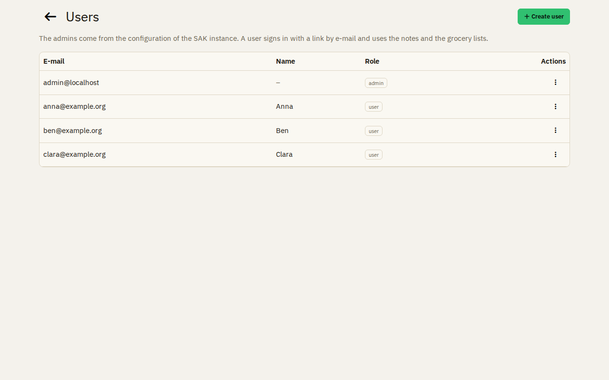

# Multiple users

In the user mode **Multiple users**, the admin adds users by their e-mail address. A user has no password: they
sign in with a link that the SAK instance sends by e-mail. The admin always signs in with the password of the SAK
instance, and also by e-mail when the SAK instance has an admin e-mail address.

## The mail server

The SAK instance needs a mail server (SMTP) that sends the login links: its host, its port (587 by default), a user
name and a password. The links come from `noreply@<root domain>` unless you give another sender. Many mail servers
send only from an address of their account or of a domain you verified there, so set the sender if the test fails.

Test the mail server before you use it:

```sh
sakadmin mail test --smtp-host mail.example.org --smtp-username me@example.org --to me@example.org
```

sakadmin asks for the password of the mail server, or reads it from `SAK_SMTP_PASSWORD`. With the name of a SAK
instance (`sakadmin mail test <name> --to me@example.org`), it tests the mail server of that SAK instance.

## Turn it on

- **A new SAK instance:** in the form of the [first steps](first-steps.md), select the user mode **Multiple users**
  and fill in the mail server. On the command line: `sakadmin create <name> --root-domain example.org --user-mode
  multi --smtp-host mail.example.org --smtp-username me@example.org`.
- **A SAK instance for a single user:** change its settings and deploy it
  ([Look after your SAK instance](manage.md#change-the-settings)).

## Add users

Sign in to the web app as the admin and open **Users**. Add a user with their e-mail address. The user opens the SAK
address, enters the e-mail address and gets a link that signs them in.



The ⋮ menu of a user has **Send links to the Android apps**, an e-mail with the links of the
[native Android apps](apps/android/native-apps.md).

## What users share

Notes are private. A grocery list or a todo list is private, or shared with all users of the SAK instance. Static
hosting, the redirects and the settings are for the admin only.
